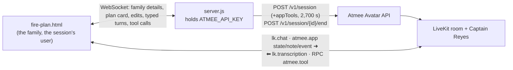

# Station 12 Fire Plan: a family's home escape plan, made with a fire captain

A family calls Captain Jake Reyes, a (made-up) fire captain, and in about fifteen minutes they
build their home fire escape plan together: two ways out of every room, a meeting spot outside,
their smoke alarms, and a rehearsed 911 call. They leave with a printed one-page plan for the
fridge. The planning brief is [BRIEF.md](BRIEF.md).

- Page: [`public/fire-plan.html`](../../public/fire-plan.html)
- Behaviour: the `fire-plan` section of [`usecases/index.js`](../../usecases/index.js)
- Shared: [`server.js`](../../server.js) (API key, sessions, conductor, relay), [`public/common.js`](../../public/common.js) (room, tools, relay hold)

## Use case

For a parent and kids at home on a laptop or tablet.

1. The family enters its name, the kind of home and the kids' ages, and calls by voice or by typing.
2. Captain Reyes greets them and asks who lives there and what the home is like.
3. Room by room he agrees two ways out with them; each room appears on the plan card as soon as it is agreed.
4. They pick a meeting spot outside, list their smoke alarms (tested or not) and agree a monthly test.
5. A child rehearses the 911 call with the captain playing the dispatcher.
6. He reviews the card with them, marks it finished, and they print it.

The family can fix the card by hand (remove a room or an alarm, change the meeting spot); the
captain hears of each edit. A bar under the header always says that a fire right now means
getting out and calling 911, and the page itself watches the family's words for a fire
happening now and covers the screen with that instruction.

## Architecture



## How it uses the Atmee API

**1. Conductor (agenda)**: six steps, each ending on what was said: `meet` → `exits` →
`meeting_spot` → `alarms` → `call_911` → `review`. Every step's instructions start with "Mark
this step with mark_step …", because the agenda can't tell the page where it is. The graph is
`firePlan.conductor` in `usecases/index.js`; the server sets it before each session (see the
key finding below).

**2. Session with app tools**: `POST /v1/session` with `maxDurationSeconds: 2700` (the app's
own `maxSeconds`, over the server's `MAX_SECONDS`) and the five tools below, all `notify`: the
captain never waits on the page.

**3. Room messages the page sends** (built in `usecases/index.js`, relayed by `common.js`):

| when | message |
|---|---|
| right after joining | `atmee.app` note: the family's name, home and kids' ages ("speak to the kids in simple words") |
| linked, and after every change to the card | `atmee.app` state: `Fire plan app state. On the family's plan card now. Step: alarms. Rooms with two ways out: … Meeting spot: … Smoke alarms: …` |
| the family edits the card by hand | `atmee.app` event: `The family just changed their plan card by hand: removed the room "Garage"…` |
| the family types | `lk.chat` with the text |

## App tools

| tool | mode | what the page does |
|---|---|---|
| `mark_step {step}` | notify | moves the step tracker in the header |
| `add_room {room, exit_1, exit_2}` | notify | adds (or replaces, by room name) a row on the plan card |
| `set_meeting_spot {place}` | notify | fills the meeting spot |
| `log_smoke_alarm {location, tested}` | notify | adds (or updates) an alarm, ticked if tested this month |
| `finish_plan {}` | notify | marks the plan finished and ready to print; refused while no room is written down |

The tools are written as the captain writing the family's plan down, in his role, and the
instructions say to write first, then speak.

## Run it

```
# .env
ATMEE_BASE_URL=https://staging.atmanity.us
ATMEE_API_KEY=…      # atmee keys create --name "Station 12 Fire Plan" --avatar <id> --spend-cap 100 --out .env
PORT=3334
node --env-file=.env server.js        # the host: apps/fire-plan/avatar.json (AVATAR_FIRE_PLAN overrides it)
open http://localhost:3334/fire-plan.html     # add ?debug to see relays and tool calls
```

The host is Captain Jake Reyes (`83fcbd7d-…`, staging), a v2 avatar made for this app: his
persona's mission is building a family's escape plan, so the agenda and tools fit his role.

## Tested (staging, 2026-10-26, avatar "Captain Jake Reyes")

Three typed runs, driven headless as a family of four in a two-bedroom, second-floor apartment.

| | run 1 (no agenda) | run 2 (agenda set) | run 3 (alert fix) |
|---|---|---|---|
| greeting, then asks who lives there | ✓ | ✓ | ✓ |
| `add_room` ×3, each right after it was agreed | ✓ | ✓ | ✓ |
| `set_meeting_spot` | ✓ | ✓ | ✓ |
| `log_smoke_alarm` ×2 (hallway tested, kitchen not) | ✓ | ✓ | ✓ |
| `mark_step` in order | 4 of 6 (no `meet`, no agenda) | exits → meeting_spot → alarms → call_911 → review | held at `alarms` (below) |
| `finish_plan`, card printed | ✓ | ✓ | – |
| "my kitchen is on fire" → full-screen alert, captain says to get out and call 911 | ✓ | ✓ | ✓ |
| no alert during the 911 rehearsal | – | ✗ (false alarm) | ✓ |
| session `completed`, `ended_by_api`, billed | 238 s | 272 s | 255 s |

Run 2, the review step, in his words: "You've got two ways out of every room using your doors
and that great balcony, your safe meeting spot at the big oak tree, and your smoke alarm
checklist ready to go. Since it all looks good, I just marked your plan as completely finished!"

In run 3 he stayed on `alarms` because he asked whether there were alarms in the bedrooms and
the fixed script never answered: the agenda holds a step until its condition is met.

## Findings and limitations

- **An avatar-bound key can't set the agenda.** `PUT /v1/avatars/{id}/conductor` answers
  `403 insufficient_scope` for this app's key (scopes `sessions`, `avatars:write`, bound to the
  avatar). The conductor was set once by the account owner (`set_conductor`), and it stays on
  the avatar; the server's own attempt fails harmlessly each start. Platform finding to raise.
- **The emergency check is a phrase list**, and it is off during the 911 rehearsal step, where
  saying "there's a fire at our address" is the point. Before that fix, the rehearsal raised
  the alert (run 2). The captain's guardrail is the second path.
- **He sometimes says he is writing things down** ("I'm adding the living room to your plan card
  right now"), which fits the scene, and opens a caption with a filler word ("Uhhh", "Right").
- **The first step is never marked**: he greets before the agenda's first instruction, so the
  page starts on `meet` by itself.
- **Persona per avatar**: his mission is the plan's everywhere he is used.
- **One live session per avatar**: one family at a time.
- **45-minute cap**: a countdown shows the time left; the card stays on screen after the end.
- **Check-ins**: he speaks up after about 10 s of silence; it suits a guide.
- **Typed turns while he speaks** are held until his turn ends (`common.js`).
