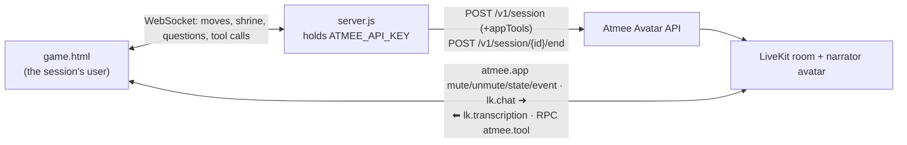

# Isle of Whispers: a narrated treasure hunt with an oracle

A 4x4 island map. The narrator tells each step of the player's walk as it happens, and speaks
with the player only at the oracle's shrine. There, the oracle can reveal where things lie and
grant gifts.

- Page: [`public/game.html`](../../public/game.html)
- Behaviour: the `game` section of [`usecases/index.js`](../../usecases/index.js) (about lines 226–249)
- Shared: [`server.js`](../../server.js) (API key, sessions, relay), [`public/common.js`](../../public/common.js) (room, tools, relay hold)

## Use case

For interactive fiction and games where the avatar narrates events and is talked to only at
certain moments.

1. From the title screen the player begins the tale. The narrator welcomes them, and the
   landing beach is told.
2. The player moves with the arrow keys or by clicking a glowing tile. Each move is narrated
   in a sentence or two, and the chronicle records it. The fog lifts as they explore, and
   finding the key or the skeleton's map fills a satchel slot.
3. At the oracle's shrine a text box opens and the oracle listens. Asked where the key (chest,
   map) lies, it consults the island and answers cryptically while that tile glows on the map.
   Asked for light or luck, it gives the lantern (which lights the tiles around the player) or
   the charm.
4. Leaving the shrine silences the player again. Opening the chest with the key wins the game.

## Architecture



## How it uses the Atmee API

**Session with app tools** ([`server.js`](../../server.js) `startSession`, about line 94). There is no conductor:
the story is driven by the game's events.

```http
POST /v1/session
{ "avatarId": "<avatarId from apps/game/avatar.json>", "maxDurationSeconds": 900,
  "appTools": { "instructions": "You narrate this island, and at the oracle's shrine you also voice the oracle; these are the oracle's powers, used only while the player kneels there. … call reveal_clue first and answer from what it tells you … whenever your words hand over, bestow or grant anything, call give_item for it first …",
    "tools": [
      { "type": "function", "name": "reveal_clue", "parameters": { "type": "object", "properties": { "seek": { "type": "string", "enum": ["key","chest","map"] } }, "required": ["seek"] }, "x-atmee": { "mode": "await", "timeoutSeconds": 5 } },
      { "type": "function", "name": "give_item",   "parameters": { "type": "object", "properties": { "item": { "type": "string", "enum": ["lantern","charm"] } }, "required": ["item"] }, "x-atmee": { "mode": "notify" } } ] } }
```

**Room messages** (`game.onLinked` / `game.onUser`):

| when | message |
|---|---|
| linked | `atmee.app` `mute` (the player is heard as silence), and `state` "You are the narrator of a short treasure-hunt game … You speak ONLY when the game tells you something happened …" |
| every move | `atmee.app` `{"type":"event","ttl_s":12,"text":"The player walks to a half-buried key. They pull a rusty key from the sand."}` |
| entering the shrine | `unmute`, a `state` ("The player is at the oracle's shrine and may now talk to you …"), and an `event` ("Greet them as the oracle and invite one question") |
| a question at the shrine | `lk.chat` with the text (only while at the shrine) |
| leaving the shrine | `mute`, and a `state` ("Back to narrating only") |

## App tools

Handlers: `const tools` in [`public/game.html`](../../public/game.html) (about line 219).

| tool | mode | what the page does |
|---|---|---|
| `reveal_clue {seek: key/chest/map}` | await, 5 s | marks that tile on the map (it glows and the fog lifts), adds a line to the chronicle, and answers with where it lies relative to the player, e.g. `The key lies at "A half-buried key", 1 step north of the shrine. It now glows on the player's map.` If the player already holds it, it says so. |
| `give_item {item: lantern/charm}` | notify | puts the gift in the satchel; the lantern lights the tiles around the player as they walk. |

Both handlers throw when the player isn't at the shrine, which the avatar hears as `error: …`.

Why these tools: the island's secrets belong to the game, so the oracle asks (`await`) instead
of inventing a location, and speaks from the answer. The satchel is the game's state too, so a
gift exists only once `give_item` puts it there. The instructions say so explicitly: in
earlier runs the oracle sometimes said "take this lantern" without calling the tool.

## Run it

```
ATMEE_BASE_URL=https://staging.atmanity.us
ATMEE_API_KEY=…            # scope: sessions
node --env-file=.env server.js   # the host: apps/game/avatar.json (AVATAR_GAME overrides it)
open http://localhost:3333/game.html        # ?debug shows relays, held times and tool calls
```

Each app has its own avatar; the narrator's voice and manner come from its persona.

## Tested (staging, testuser account, 2026-10-23, avatar "Maren")

One confirming pass, driven headless: beach → footprints → campfire → shrine, then three
questions at the shrine.

- Went live with the face showing; each move was narrated after that move. One relay was held
  10.8 s behind the greeting; all the others went out within 1 ms.
- "Where does the key lie?" → `reveal_clue {seek: key}`. The key's tile glowed, and the oracle
  answered from the result ("just one step north …").
- "Could you grant me some light?" → `give_item lantern`, and the lantern appeared in the
  satchel.
- "Anything to bring me luck?" → `give_item charm`.

Across earlier rounds on other accounts, the oracle sometimes narrated a gift without calling
`give_item`. Since the instruction was tightened, 5 of the 6 gifts asked for went through the
tool; the miss was in a run before the relay hold, where the request arrived while the oracle
was still answering the previous question. The off-shrine error path was checked only by calling the handler
directly; the avatar was never seen calling a tool away from the shrine.

## Limitations

- **The avatar speaks up on its own.** Causeur checks in after about 10 s of silence (not
  tunable), so an event-only narrator still says something between moves.
- **Mid-turn messages are dropped.** A move made while the narrator is still speaking is held
  until its turn ends (at most 15 s); moves in quick succession are narrated with a lag.
- **Muting is per message, not per turn.** The game mutes and unmutes the player itself on
  shrine entry and exit.
- **One live session per avatar**: one player at a time per narrator avatar.
