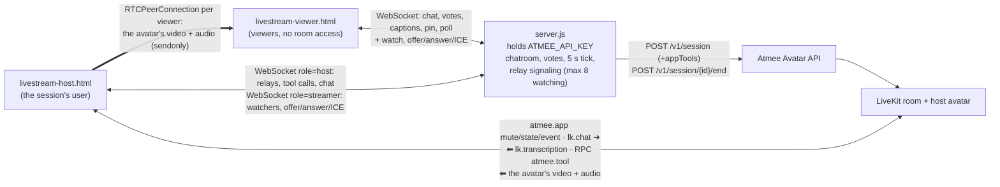

# Nightcap Live: an AI co-host that runs a stream's chat

A late-night tech stream. The AI host talks with the chat: it answers questions by name, reacts
to the rest of the chat every few seconds, pins what matters, and runs polls that viewers vote
in.

- Pages: [`public/livestream-host.html`](../../public/livestream-host.html) (the creator studio, the session's user) and [`public/livestream-viewer.html`](../../public/livestream-viewer.html) (the viewers: the stream and its chat). A **Streamer / Viewer** switch at the top of both pages moves between them (the studio hides it once live); `?role=viewer` / `?role=streamer` on either URL does the same.
- Video relay: [`public/livestream-relay.js`](../../public/livestream-relay.js) (the studio forwards the avatar to each viewer, browser to browser)
- Behaviour: the `livestream` section of [`usecases/index.js`](../../usecases/index.js) (about lines 28–97)
- Shared: [`server.js`](../../server.js) (API key, sessions, the chatroom over WebSocket, the video relay's signaling, votes, the 5 s tick), [`public/common.js`](../../public/common.js) (room, tools, relay hold)

## Use case

For creators and brands that want a host that keeps a chat going.

1. The creator opens the studio and presses **Go live**. The host introduces the show.
2. Viewers open the viewer link (or pick **Viewer** on the switch). They see and hear the host
   (the video starts muted; one tap unmutes it), and they type. A message with a "?" in it (or starting
   with "host") goes to the host as a question, and it answers by name. Everything else is
   batched into a digest every 20 s that the host reacts to.
3. Asked to pin something, or when a line deserves it, the host pins it to the top of the chat
   for everyone.
4. Asked for a poll, or when the chat disagrees, it starts one. Viewers vote with a tap, the
   bars update live, and when the poll closes after 45 s the host announces the result.
5. The studio shows the LIVE badge, viewer count, message count and stream time left.

## Architecture



Viewers never join the LiveKit room. The API gives one user token per session, so the server
keeps the chatroom itself and echoes the host's captions to the viewers, and the studio page
forwards what it receives to them:

1. Once live, the studio opens a second socket (`role=streamer`). The server sends it the
   viewers already waiting (`watchers`), and tells every viewer the stream is on.
2. A viewer asks to watch (`watch`) when its socket opens. Past `LIVESTREAM_MAX_WATCHERS`
   (default 8) it gets `watch-full`: it keeps chatting and asks again every 10 s.
3. For each watcher the studio makes an `RTCPeerConnection` with a send-only video and audio
   transceiver and sends the offer; the server passes `rtc` messages (offer, answer, ICE) between
   the two pages by the viewer's connection id. The avatar's LiveKit tracks go onto the senders
   with `replaceTrack`, so a face that arrives later, or a track LiveKit swaps, reaches viewers
   without a new offer.
4. A viewer that reloads or leaves frees its connection (`watcher-left`); a fresh one gets a
   fresh offer. When the studio ends, reloads or loses its socket, the server tells the viewers
   the stream is offline and they drop the connection; going live again re-offers to everyone
   still there. A viewer whose connection fails, or plays nothing in 15 s, asks to watch again.

## How it uses the Atmee API

**Session with app tools** ([`server.js`](../../server.js) `startSession`, about line 99). No conductor.

```http
POST /v1/session
{ "avatarId": "<avatarId from apps/livestream/avatar.json>", "maxDurationSeconds": 900,
  "appTools": { "instructions": "You run this stream's chat as its host, and the chat only shows what your tools put there. … When a viewer asks for a poll … call start_poll right away in that turn … A pin or a poll exists only once its tool is called, so call it before you speak of it. …",
    "tools": [
      { "type": "function", "name": "pin_message", "parameters": { "type": "object", "properties": { "text": { "type": "string", "maxLength": 140 } }, "required": ["text"] }, "x-atmee": { "mode": "notify" } },
      { "type": "function", "name": "start_poll",  "parameters": { "type": "object", "properties": { "question": { "type": "string", "maxLength": 120 }, "options": { "type": "array", "minItems": 2, "maxItems": 4, "items": { "type": "string", "maxLength": 40 } } }, "required": ["question","options"] }, "x-atmee": { "mode": "notify" } } ] } }
```

**Room messages** (`livestream.onLinked` / `onViewerChat` / `tick` / `onTool`):

| when | message |
|---|---|
| linked | `atmee.app` `mute` (the host can't hear anyone; viewers type), and `state` "You are hosting a live stream. 3 viewer(s) are watching … Recent chat: … Pinned in the chat: "…". A poll is open: "…"." |
| a viewer asks (`?` or `@host`) | `lk.chat` `mika42 asks: Can you run a poll so we can vote?` |
| every 20 s, if there is other chat | `atmee.app` `{"type":"event","ttl_s":30,"text":"New chat messages (4): …. React to the chat in a sentence or two."}` and a fresh `state` |
| a poll closes (45 s) | `atmee.app` `{"type":"event","ttl_s":30,"text":"Your poll \"Rust vs Go for backend?\" closed with 1 vote(s): \"Rust\" 0, \"Go\" 1. Tell the chat the result in a sentence."}` |

## App tools

The studio's handlers (`const tools` in `livestream-host.html`, about line 127) acknowledge
each call. The page passes the call on to the server, and the server's `livestream.onTool`
does the work, because viewers have to see the result too.

| tool | mode | what happens |
|---|---|---|
| `pin_message {text}` | notify | the server keeps the pin and sends it to the studio and every viewer (new viewers get it on join); it replaces the last pin. |
| `start_poll {question, options[2..4]}` | notify | the server opens a 45 s poll and sends it to everyone; viewers vote (one vote each, changeable); the bars update live; when it closes the host gets the result as an event. |

Why these tools: pins and polls are the chat's own features, and the host decides when to use
them. They are `notify` so the host keeps talking; the poll's result comes back later as an
event, not as a tool answer.

## Run it

```
ATMEE_BASE_URL=https://staging.atmanity.us
ATMEE_API_KEY=…            # scope: sessions
node --env-file=.env server.js   # the host: apps/livestream/avatar.json (AVATAR_LIVESTREAM overrides it)
open http://localhost:3333/livestream-host.html     # Go live; "Copy chat link" opens the viewer page
```

Each app has its own avatar; the host's name and style are its persona.

## Tested (staging, testuser account, 2026-10-23, avatar "Nico Vale")

The video relay (headless Chromium, fake media devices, microphone permission only):

- A viewer opened before going live showed "The stream is offline"; once live it played the
  relayed stream (256×256 at first, 512×512 after about 20 s, `currentTime` advancing, inbound
  video and audio bytes growing in `getStats`, one audio track). A second viewer opened after
  going live played too; the studio's badge read `📡 2/2 watching` (cap set to 2 for the test).
- "Host, what are you building tonight?" from a viewer was answered by name ("Absolutely nothing,
  leo48, …").
- A third viewer saw "The stream is full", then got in about 10 s after a watcher left. A
  reloaded viewer reconnected and played again in about 3 s.
- Ending the stream, and reloading the studio, put every viewer on "The stream is offline" at
  once; going live again re-offered to the waiting viewer and it played. Every session ended 200.

The chat and tools:

One confirming pass, with one viewer:

- Went live with the face showing; the host introduced the show.
- "Can you pin tonight's topic …?" → `pin_message` about 3 s later; the pin showed in the
  studio and the viewer page.
- "Can you run a poll so we can vote?" was held 6.1 s while the host finished speaking. Then
  `start_poll` fired (Rust/Go), and the poll showed in both pages.
- The viewer's vote counted (Go 100%). The close event was relayed 1 ms after the poll closed,
  and the host announced the result about 7 s later.

In earlier rounds, before the relay hold and the tightened instruction, a viewer message
landing mid-sentence cut the host off, and the host once offered a poll instead of starting it
(the poll came 20+ s late). Neither happened in this pass.

## Limitations

- **No audience in the room.** `POST /v1/session` gives exactly one user token, with no viewer
  tokens and no egress. This demo relays the studio's copy of the avatar to each viewer from the
  studio's browser. A real stream must re-stream the studio's video (OBS, or re-publishing into
  your own LiveKit room or a media server).
- **The relay is browser to browser, with STUN only and no TURN** (`stun:stun.l.google.com:19302`).
  It works where the studio and the viewers can reach each other directly: one LAN, a tailnet,
  most home networks. Behind symmetric NATs or strict firewalls the viewer stays on
  "Tuning in…" and keeps the chat.
- **Each viewer costs the studio its upload** (one encode and one stream per viewer), so at most
  8 watch at once (`LIVESTREAM_MAX_WATCHERS`); the rest see "The stream is full" and get in when
  a spot opens. The video starts small and sharpens over a few seconds as the connection ramps.
- **The studio must stay open and in view.** Viewers watch through it: closing or reloading it
  ends the stream, and LiveKit's adaptive stream may pause the avatar's video while the studio
  tab is hidden.
- **Sound needs a tap.** Browsers block audio that starts on its own, so the viewer's video
  starts muted with a "Tap to unmute" button.
- **Session length.** Capped by the plan (900 s here). A longer show chains sessions, with a
  visible cut, and only one live session per avatar is allowed at a time.
- **Mid-turn messages are dropped.** `common.js` holds viewer questions and digests until the
  host's turn ends (at most 15 s). A busy chat therefore waits, and an event past its `ttl_s`
  isn't spoken.
- **The avatar speaks up on its own** when the chat is quiet (the check-in isn't tunable).
- **No server-side event stream.** The chat transcript exists only because the studio page
  echoes the captions to the server.
