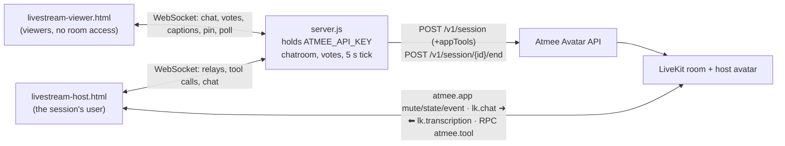

# Nightcap Live: an AI co-host that runs a stream's chat

A late-night tech stream. The AI host talks with the chat: it answers questions by name, reacts
to the rest of the chat every few seconds, pins what matters, and runs polls that viewers vote
in.

- Pages: [`public/livestream-host.html`](../../public/livestream-host.html) (the creator studio, the session's user) and [`public/livestream-viewer.html`](../../public/livestream-viewer.html) (the viewers' chat)
- Behaviour: the `livestream` section of [`usecases/index.js`](../../usecases/index.js) (about lines 28–97)
- Shared: [`server.js`](../../server.js) (API key, sessions, the chatroom over WebSocket, votes, the 5 s tick), [`public/common.js`](../../public/common.js) (room, tools, relay hold)

## Use case

For creators and brands that want a host that keeps a chat going.

1. The creator opens the studio and presses **Go live**. The host introduces the show.
2. Viewers open the chat link (the viewer page) and type. A message with a "?" in it (or starting
   with "host") goes to the host as a question, and it answers by name. Everything else is
   batched into a digest every 20 s that the host reacts to.
3. Asked to pin something, or when a line deserves it, the host pins it to the top of the chat
   for everyone.
4. Asked for a poll, or when the chat disagrees, it starts one. Viewers vote with a tap, the
   bars update live, and when the poll closes after 45 s the host announces the result.
5. The studio shows the LIVE badge, viewer count, message count and stream time left.

## Architecture



Viewers never join the LiveKit room. The API gives one user token per session, so the server
keeps the chatroom itself and echoes the host's captions to the viewers.

## How it uses the Atmee API

**Session with app tools** ([`server.js`](../../server.js) `startSession`, about line 94). No conductor.

```http
POST /v1/session
{ "avatarId": "<AVATAR_LIVESTREAM>", "maxDurationSeconds": 900,
  "appTools": { "instructions": "You run this stream's chat as its host, and the chat only shows what your tools put there. … When a viewer asks for a poll … call start_poll right away in that turn … A pin or a poll exists only once its tool is called, so call it before you speak of it. …",
    "tools": [
      { "type": "function", "name": "pin_message", "parameters": { "type": "object", "properties": { "text": { "type": "string", "maxLength": 140 } }, "required": ["text"] }, "x-atmee": { "mode": "notify" } },
      { "type": "function", "name": "start_poll",  "parameters": { "type": "object", "properties": { "question": { "type": "string", "maxLength": 120 }, "options": { "type": "array", "minItems": 2, "maxItems": 4, "items": { "type": "string", "maxLength": 40 } } }, "required": ["question","options"] }, "x-atmee": { "mode": "notify" } } ] } }
```

**Room messages** (`livestream.onLinked` / `onViewerChat` / `tick` / `onTool`):

| when | message |
|---|---|
| linked | `atmee.app` `mute` (the host can't hear anyone; viewers type), and `state` "You are hosting a live stream. 3 viewer(s) are watching … Recent chat: … Pinned in the chat: "…". A poll is open: "…"." |
| a viewer asks (`?` or `@host`) | `lk.chat` `mika42 asks: Can you run a poll so we can vote?` |
| every 20 s, if there is other chat | `atmee.app` `{"type":"event","ttl_s":30,"text":"New chat messages (4): …. React to the chat in a sentence or two."}` and a fresh `state` |
| a poll closes (45 s) | `atmee.app` `{"type":"event","ttl_s":30,"text":"Your poll \"Rust vs Go for backend?\" closed with 1 vote(s): \"Rust\" 0, \"Go\" 1. Tell the chat the result in a sentence."}` |

## App tools

The studio's handlers (`const tools` in `livestream-host.html`, about line 119) acknowledge
each call. The page passes the call on to the server, and the server's `livestream.onTool`
does the work, because viewers have to see the result too.

| tool | mode | what happens |
|---|---|---|
| `pin_message {text}` | notify | the server keeps the pin and sends it to the studio and every viewer (new viewers get it on join); it replaces the last pin. |
| `start_poll {question, options[2..4]}` | notify | the server opens a 45 s poll and sends it to everyone; viewers vote (one vote each, changeable); the bars update live; when it closes the host gets the result as an event. |

Why these tools: pins and polls are the chat's own features, and the host decides when to use
them. They are `notify` so the host keeps talking; the poll's result comes back later as an
event, not as a tool answer.

## Run it

```
ATMEE_BASE_URL=https://staging.atmanity.us
ATMEE_API_KEY=…            # scope: sessions
AVATAR_LIVESTREAM=…        # an avatar whose persona is a stream host
node --env-file=.env server.js
open http://localhost:3333/livestream-host.html     # Go live; "Copy chat link" opens the viewer page
```

Each app has its own avatar; the host's name and style are its persona.

## Tested (staging, testuser account, 2026-10-23, avatar "Nico Vale")

One confirming pass, with one viewer:

- Went live with the face showing; the host introduced the show.
- "Can you pin tonight's topic …?" → `pin_message` about 3 s later; the pin showed in the
  studio and the viewer page.
- "Can you run a poll so we can vote?" was held 6.1 s while the host finished speaking. Then
  `start_poll` fired (Rust/Go), and the poll showed in both pages.
- The viewer's vote counted (Go 100%). The close event was relayed 1 ms after the poll closed,
  and the host announced the result about 7 s later.

In earlier rounds, before the relay hold and the tightened instruction, a viewer message
landing mid-sentence cut the host off, and the host once offered a poll instead of starting it
(the poll came 20+ s late). Neither happened in this pass.

## Limitations

- **No audience in the room.** `POST /v1/session` gives exactly one user token, with no viewer
  tokens and no egress. Viewers see captions and chat here, not the avatar. A real stream must
  re-stream the studio's video (OBS, or re-publishing into your own LiveKit room).
- **Session length.** Capped by the plan (900 s here). A longer show chains sessions, with a
  visible cut, and only one live session per avatar is allowed at a time.
- **Mid-turn messages are dropped.** `common.js` holds viewer questions and digests until the
  host's turn ends (at most 15 s). A busy chat therefore waits, and an event past its `ttl_s`
  isn't spoken.
- **The avatar speaks up on its own** when the chat is quiet (the check-in isn't tunable).
- **No server-side event stream.** The chat transcript exists only because the studio page
  echoes the captions to the server.
