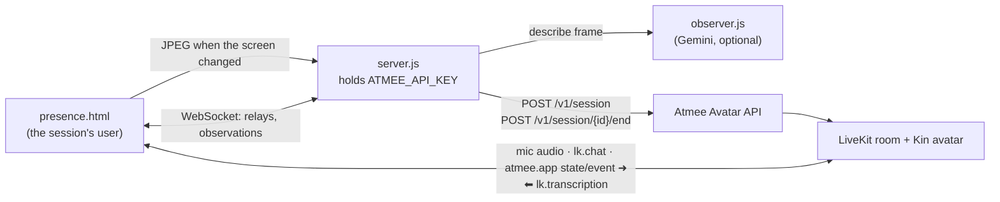

# Kin: a companion that sits next to you while you work

Kin floats in a bubble beside your screen. It sees what you are doing through short
descriptions the app sends, and speaks up only when something is worth a word: a failing test,
a finished task, a detour to cat videos.

- Page: [`public/presence.html`](../../public/presence.html)
- Behaviour: the `presence` section of [`usecases/index.js`](../../usecases/index.js) (about lines 206–223), and the observer [`usecases/observer.js`](../../usecases/observer.js)
- Shared: [`server.js`](../../server.js) (API key, sessions, the `/api/presence/frame` route), [`public/common.js`](../../public/common.js) (room, relay hold)

## Use case

For companion and coaching products where the avatar reacts to what the user does, not only
to what they say.

1. The welcome screen explains what Kin sees. The user chooses to share their real screen or
   run a simulated work session, with or without a microphone.
2. Kin joins and says hello. The shared screen sits in a monitor frame; a "What Kin noticed"
   feed lists each description.
3. While the user works, Kin stays quiet unless something noteworthy happens (in the simulated
   session: a code editor, then a failing test, the fix committed, a cat video).
4. The user can talk to Kin, or type, at any time.

## Architecture



The observer is the app's own. The Avatar API has no screen or video input; the app turns
frames into text and sends that text as context.

## How it uses the Atmee API

**Session** ([`server.js`](../../server.js) `startSession`, about line 94): no conductor, no app tools.

```http
POST /v1/session
{ "avatarId": "<avatarId from apps/presence/avatar.json>", "maxDurationSeconds": 900,
  "metadata": { "app": "atmee-usecase-demos", "usecase": "presence" } }
```

**The observation loop.** The page captures a frame every 5 s (screen share) or per simulated
scene (every 25 s), and posts it to `/api/presence/frame` only when the pixels changed (or after
60 s). The server describes it with `describeFrame` and turns the result into room messages
(`presence.onObservation`):

| when | message |
|---|---|
| linked | `atmee.app` `{"type":"state","text":"You are a quiet companion sitting next to the user while they work. … never narrate routine activity."}` |
| every description | `atmee.app` `{"type":"state","text":"You are a quiet companion … What the user's screen shows now: The user is writing an audio normalization function in Python."}` |
| something noteworthy | `atmee.app` `{"type":"event","ttl_s":15,"text":"Something changed on the user's screen: The user took a break … React briefly if it deserves a word; otherwise stay quiet."}` |
| the user types | `lk.chat` with the text |

A `state` replaces the previous one, so every state repeats the companion role in front of the
screen description.

## App tools

None, by design. In this app information only flows from the app to the avatar (state and
events); Kin has nothing to make the app do. A tool would fit if Kin needed to act, for
example a `get_recent_activity` (await) to fetch a longer history on request.

## Run it

```
ATMEE_BASE_URL=https://staging.atmanity.us
ATMEE_API_KEY=…            # scope: sessions
GEMINI_API_KEY=…           # optional; without it the observer only reports "the screen changed"
GEMINI_MODEL=…             # optional, overrides the default model
node --env-file=.env server.js   # the host: apps/presence/avatar.json (AVATAR_PRESENCE overrides it)
open http://localhost:3333/presence.html    # ?debug shows relays and held times
```

Each app has its own avatar. Kin's name, voice and manner are the avatar's persona.

## Tested (staging, testuser account, 2026-10-23, avatar "Kin")

Two short simulated-session passes, typing only:

- Went live with the face showing; no tools declared.
- Reacted to the screen ("That audio normalization function looks like it's coming together
  nicely"), and to the noteworthy cat-video event ("Everyone needs a little pause now and
  then").
- Bug found and fixed: the first screen description replaced the companion role, because a
  state replaces the previous one. Every state now carries the role.
- In about 100 s only 2 of the 4 simulated scenes produced an observation. Not investigated.
- Kin also checked in unprompted after a quiet stretch ("How is that code coming along?").

## Limitations

- **The avatar speaks up on its own.** Causeur's check-in after about 10 s of silence isn't
  tunable per session, so a companion meant to stay quiet still comments on quiet stretches.
- **No screen or video input in the API.** The app runs its own observer (VLM) and sends text.
  That works, but latency and cost are the app's.
- **Mid-turn messages are dropped.** `common.js` holds each state and event until Kin's turn
  ends (at most 15 s); an event older than its `ttl_s` is no longer spoken.
- **One live session per avatar**: one user per Kin avatar at a time.
