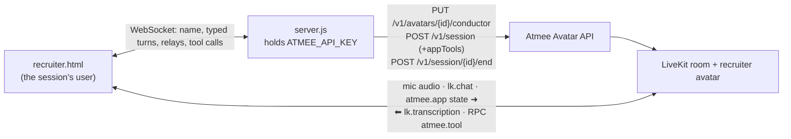

# Northwind Talent: a first-round screening call with an AI recruiter

A ten-minute screening for a Senior Backend Engineer (Go) role. The recruiter follows a fixed
agenda, takes notes for the hiring team as the candidate answers, and answers questions only
from the job description.

- Page: [`public/recruiter.html`](../../public/recruiter.html)
- Behaviour: the `recruiter` section of [`usecases/index.js`](../../usecases/index.js) (about lines 99–136)
- Shared: [`server.js`](../../server.js) (API key, sessions, conductor, relay), [`public/common.js`](../../public/common.js) (room, tools, relay hold)

## Use case

For recruiting platforms that want structured first-round screens at any hour.

1. The candidate sees a pre-join screen with the job card, enters a name, and joins with a
   microphone or by typing.
2. The recruiter greets them by name and asks for a short introduction.
3. The live agenda (Introductions → Your background → Must-haves → Logistics → Your
   questions → Next steps) moves as the recruiter goes, and a "Screening notes" panel fills
   with one line per answer (experience, project, Go, PostgreSQL, on-call, notice, location,
   salary, questions).
4. The candidate asks questions. Anything the job description doesn't cover, the recruiter
   says the hiring team will follow up on.
5. The recruiter wraps up (next step: a technical interview within a week). The candidate
   leaves to a thank-you screen.

## Architecture



## How it uses the Atmee API

**1. Conductor** ([`server.js`](../../server.js) `ensureConductor`, about line 81). Every step except the last
moves on a judged condition and otherwise stays:

```http
PUT /v1/avatars/{AVATAR_RECRUITER}/conductor
{ "speakAfterS": 1.0, "graph": { "start": "greet", "nodes": [
  { "id": "greet",      "instructions": "Mark this step with set_agenda_step greet. Greet the candidate by name …",
    "edges": [{ "to": "background", "when": "The candidate has introduced themselves." }, { "to": "greet" }] },
  { "id": "background", "edges": [{ "to": "fit",       "when": "You have heard about their current role and one concrete project." }, { "to": "background" }] },
  { "id": "fit",        "edges": [{ "to": "logistics", "when": "All four must-haves have been discussed." }, { "to": "fit" }] },
  { "id": "logistics",  "edges": [{ "to": "questions", "when": "Logistics are covered." }, { "to": "logistics" }] },
  { "id": "questions",  "instructions": "… Answer only from the job description you were given; … Never make up numbers or details.",
    "edges": [{ "to": "wrap", "when": "The candidate has no more questions." }, { "to": "questions" }] },
  { "id": "wrap", "emotion": "warm", "instructions": "First mark this step with set_agenda_step wrap, then thank them …" }
] } }
```

Each step's instructions start with "Mark this step with set_agenda_step <step>", because the
page's agenda moves only through that tool.

**2. Session with app tools** ([`server.js`](../../server.js) `startSession`, about line 94):

```http
POST /v1/session
{ "avatarId": "<AVATAR_RECRUITER>", "maxDurationSeconds": 900,
  "appTools": { "instructions": "You keep the hiring team's screening notes in the call app while you talk. The candidate's agenda moves only when you mark it … always mark wrap before you thank the candidate and say goodbye. … never mention the agenda, the notes or marking them.",
    "tools": [
      { "type": "function", "name": "set_agenda_step", "parameters": { "type": "object", "properties": { "step": { "type": "string", "enum": ["greet","background","fit","logistics","questions","wrap"] } }, "required": ["step"] }, "x-atmee": { "mode": "notify" } },
      { "type": "function", "name": "record_answer",   "parameters": { "type": "object", "properties": { "topic": { "type": "string", "enum": ["current_role","project","years_experience","production_go","postgresql","on_call","notice_period","location","salary","candidate_questions","other"] }, "summary": { "type": "string", "maxLength": 160 } }, "required": ["topic","summary"] }, "x-atmee": { "mode": "notify" } } ] } }
```

**3. Room messages the page sends**:

| when | message |
|---|---|
| linked, and when the name is known | `atmee.app` `{"type":"state","text":"Job you are screening for: Senior backend engineer (Go), remote, payments team. Must-haves: … Candidate name: Alex Chen."}` |
| the candidate types instead of speaking | `lk.chat` with the text |

With a microphone, the candidate's voice goes straight to the avatar over the room's audio.

## App tools

Handlers: `const tools` in [`public/recruiter.html`](../../public/recruiter.html) (about line 181).

| tool | mode | what the page does |
|---|---|---|
| `set_agenda_step {step}` | notify | marks that step as current and earlier ones as done. It only moves forward; an unknown step is an error. |
| `record_answer {topic, summary}` | notify | adds a line to "Screening notes" under the topic's label; a second answer on the same topic is appended. |

Why these tools: the agenda and the notes are the product's own UI, filled by the recruiter as
it works. Without them the page would have to guess from the transcript. Both are `notify`, so
the conversation never waits on the page.

## Run it

```
ATMEE_BASE_URL=https://staging.atmanity.us
ATMEE_API_KEY=…            # scopes: sessions, and avatars:write (to set the conductor)
AVATAR_RECRUITER=…         # an avatar whose persona is a recruiter
node --env-file=.env server.js
open http://localhost:3333/recruiter.html   # ?debug shows relays, held times and tool calls
```

Each app has its own avatar. The recruiter's name, role and voice come from the avatar's
persona, so make it a recruiter.

## Tested (staging, testuser account, 2026-10-23, avatar "Priya Raman")

Two full passes, each a typed candidate answering only after the recruiter finished:

| | pass 1 | pass 2 |
|---|---|---|
| conductor `PUT` | 200, 6 nodes | 200, 6 nodes |
| greetings | 1 | 1 |
| `set_agenda_step` | background → fit → logistics → questions → questions → wrap | same |
| agenda ends on "Next steps" | ✓ | ✓ |
| `record_answer` calls | 10 | 8 |
| unknown detail asked (team size) | "don't have it in front of me, the hiring team will follow up" | – |
| agenda or notes mentioned aloud | no | no |

Each step moved on at the first answer that met its condition; the second `questions` call
came when the candidate asked something, which is the expected stay. Causeur's logs show the
reply released about 1.1–1.2 s after each typed answer, and the tool calls landing about 1.5 s
after it. Before the relay hold (an earlier round on another account), one run greeted twice
and stayed on Background for four turns; neither has happened since.

## Limitations

- **The agenda can't react to tool calls.** The conductor moves on its judge's reading of the
  conversation; `set_agenda_step` only updates the page. The two agree because each step's
  instructions name the tool, not because one drives the other.
- **No live agenda state.** The API doesn't report the current step; the page shows what the
  recruiter marked.
- **Check-in after the last step.** About 10 s after the goodbye, Causeur speaks once more
  unprompted.
- **Mid-turn messages are dropped.** `common.js` holds typed turns and state until the
  recruiter's turn ends (at most 15 s).
- **One live session per avatar**: one candidate at a time per recruiter avatar.
- **No server-side event stream.** The notes exist on the page only. A real product would post
  them to its backend from the tool handler (or from `onTool` on the server).
