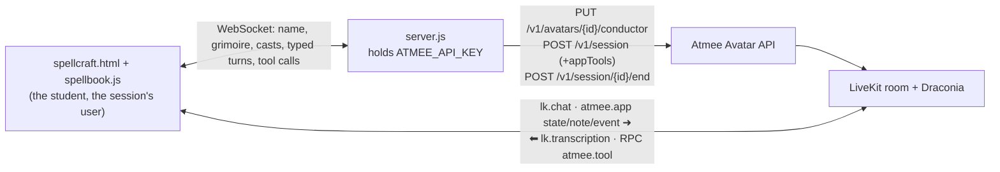

# Silverfell: a private spell lesson with Draconia Malvane

A student takes a ten-minute lesson in magic from Draconia Malvane, a haughty young Mistress of
Spellcraft with a soft centre. She reads the student's school of magic, teaches two of its
spells, sets a trial, and names their rank on a certificate they can print. Casting is the
student's own: they trace a spell's sigil on a casting circle and say its words, and the page
judges both.

Draconia and Silverfell are original: a female take on the "Malfoid" fan-art look (platinum
hair, emerald and silver, a smug half-smile), with no franchise names, places or spells. The
trend's own name folds in a slur, so the character doesn't carry it.

- Page: [`public/spellcraft.html`](../../public/spellcraft.html)
- Spellbook (schools, spells, sigils, judging): [`public/spellbook.js`](../../public/spellbook.js), tested in [`server/spellbook.test.ts`](../../server/spellbook.test.ts)
- Behaviour: the `spellcraft` section of [`usecases/index.js`](../../usecases/index.js)
- Shared: [`server.js`](../../server.js) (API key, sessions, conductor, relay), [`public/common.js`](../../public/common.js) (room, tools, relay hold)

## Use case

For anyone curious, on a laptop, tablet or phone; a fun way to show a tutor that teaches by
doing, not by talking.

1. The student gives a name and joins by voice, or without a microphone and types.
2. Draconia sizes them up with three questions and reveals their school: Ember, Tide, Gale,
   Thorn, Gloam or Lumen. The crest and the whole page take its colour.
3. She puts the school's first spell on the casting circle and teaches it. The student traces
   the dotted sigil in one stroke from the bright dot; the circle charges, and they say the
   words (or type them). The spell goes off in the school's style (flames, ripples, wind,
   leaves, shadow or light), as strong as the cast was, and she reacts to the result: grudging
   praise, the one thing to fix, or "again".
4. Once it holds, the second spell, the same way.
5. She sets a trial ("the corridor has gone pitch dark…"); the student picks the spell that
   answers it and casts.
6. She names their rank (Novice to Magister) with a remark, and the certificate appears.

## Architecture



The grimoire is the page's: it holds the spellbook, answers Draconia's tools with what to teach
next, and judges every cast itself. Draconia never sees the drawing; she hears the verdict.

## How it uses the Atmee API

**1. Conductor (agenda)**: four steps, each with its own check and a loop back, so a step's
instructions stay in force until the judge sees it done: `appraise` (three questions, then
`reveal_affinity`) → `lesson` (teach and practise both spells) → `trial` (`set_trial`, judge
the cast) → `verdict` (`award_rank`, goodbye). The graph is `spellcraft.conductor` in
`usecases/index.js`; the server sets it on the avatar before the first session.

**2. Session with app tools**: `POST /v1/session` with the four tools below, all `await`: each
answer tells Draconia what to do next, so she never needs the spellbook in her persona.

**3. Room messages the page sends** (built in `usecases/index.js`, relayed by `common.js`):

| when | message |
|---|---|
| right after joining | `atmee.app` note: the student's name |
| linked, and after every change to the grimoire | `atmee.app` state: `Spell lesson app state. Student: Ana. Their school: Ember (your reading: "…"). Its two spells, in teaching order: 1) Ignis Vela, sigil a triangle pointing up; … taught, cast 2 times, best power 91; …` |
| every cast | `atmee.app` event: `The student just cast Ignis Vela: their sigil was 91% true and they spoke its words clearly. Power 91 of 100, a brilliant cast: the spell blazed. React in one or two sentences…` (a trial cast says whether it was the right spell and asks her to judge it) |
| the student types | `lk.chat` with the text, except the words of a charged spell, which only cast it |

## App tools

| tool | mode | what the page does, and answers |
|---|---|---|
| `reveal_affinity {school, reading}` | await | shows the crest and her reading, recolours the page; answers with the school's two spells in order (words, how said, sigil, effect) |
| `teach_spell {spell}` | await | unlocks the spell's card and puts its sigil on the circle; answers with how to teach it |
| `set_trial {challenge, answer}` | await | shows the trial; refuses an answer the student hasn't learned |
| `award_rank {rank, remark}` | await | writes the certificate of rank |

Names are free text (Causeur refuses arguments that miss a schema before the page sees them),
and the page matches them: `Ember`, `fire` or `the ember school`; `1`, `the second one` or
`Vela`; `adept`. An unknown one is answered with the choices, so she can call again.

## Casting

- **The sigil**: the stroke is compared with the sigil's path in the circle (`scoreTrace`):
  how far the ink strays from the sigil and how much of the sigil the ink never came near,
  averaged. Direction and starting point don't matter. A careful trace scores 80–100, a sloppy
  one 40–70, the wrong shape under 50.
- **The words**: spoken words come from the session's own speech recognition (the user's
  `lk.transcription`), said while tracing, just before, or within 12 s after. Invented words
  are misheard many ways ("ignis bella", "looks Clara"), so they are compared by sound,
  anywhere inside what was said. Typed words work the same way.
- **Power** = the sigil's score, halved without the words: brilliant (80+), solid (60+), shaky
  (35+), fizzled.

## Run it

```
# .env
ATMEE_BASE_URL=https://staging.atmanity.us
ATMEE_API_KEY=…      # a key of the account that owns the host, with avatars:write (it sets the agenda)
PORT=3336
node --env-file=.env server.js        # the host: apps/spellcraft/avatar.json (AVATAR_SPELLCRAFT overrides it)
open http://localhost:3336/spellcraft.html     # add ?debug to see relays and tool calls
npx vitest run server/spellbook.test.ts
```

The host is Draconia Malvane (`33cdf930-…`, staging, in the demo site's account), a v2 avatar
made for this app; her iteration files are in `atmee-avatars/draconia-malvane-yds6/` in the
workspace.

## Tested (staging, 2026-10-27, avatar "Draconia Malvane")

Driven headless as a typed student, Ana, with real pointer strokes on the circle (the first
cast deliberately sloppy and without words).

| | run 1 (Gale) |
|---|---|
| three appraisal questions, one at a time, then `reveal_affinity` (Gale, "A restless spirit that reaches high, yet fears being lost in the dark.") | ✓ |
| `teach_spell 1` (Aura Celer), taught with words and sigil | ✓ |
| sloppy, wordless cast: Shaky, sigil 73%, power 37; she: "a sigil without an incantation is only half a spell, darling. You forgot to speak the words!" | ✓ |
| clean cast with words: Brilliant, power 100, praised | ✓ |
| `teach_spell 2` (Turbo Plumae) only after the first held; Brilliant | ✓ |
| `set_trial` (a stone door sliding shut, answered by Aura Celer), answer not named | ✓ |
| trial cast judged aloud, then `award_rank` Adept with "Swift of mind and light of foot; a true child of the wind.", goodbye | ✓ |
| whole lesson | about 6 minutes |

Run 2 (Ember) went the same way: a fizzled wordless cast corrected ("you forgot to speak the
incantation entirely"), Ignis Vela and Pyra Corona brilliant, an icy-wind trial answered with
Pyra Corona, Adept of Ember, session ended `200`.

## Findings and limitations

- **She read a pronunciation guide aloud** ("OW-ra KEL-er") in both runs, even when told not
  to, so she is no longer given one: the guide is on the student's spell card only.
- **Some replies were captioned twice** in run 2 (the same sentence repeated in one bubble).
- **Fillers open some captions** ("Ummm", "Yeah"), as with the other hosts.
- **Spoken words are also a turn**: saying "Aura Celer" aloud reaches Draconia as a user turn
  before the page's result does. The tool instructions tell her to wait for the result; typed
  words of a charged spell never reach the conversation.
- **The guide does the drawing for you**: tracing over the dotted sigil is the skill, not
  drawing it from memory; scores near 100 are easy with a careful hand.
- **Persona per avatar**: her mission (private lessons) is hers wherever she is used.
- **One live session per avatar**: one student at a time; 15-minute cap (the server's
  `MAX_SECONDS`).
