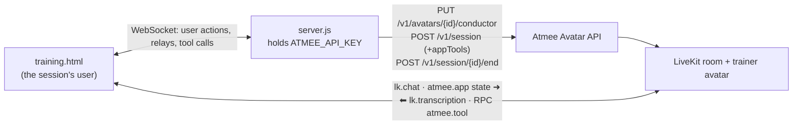

# Ledger Academy: internal training with an AI trainer

A ten-minute course module ("Incident Response Essentials"): the trainer teaches three slides on
its own, takes questions, and runs a two-question quiz whose score the course app keeps.

- Page: [`public/training.html`](../../public/training.html)
- Behaviour: the `training` section of [`usecases/index.js`](../../usecases/index.js) (about lines 138–204)
- Shared: [`server.js`](../../server.js) (API key, sessions, conductor, relay), [`public/common.js`](../../public/common.js) (room, tools, relay hold)

## Use case

For L&D teams that want a lesson taught live, with questions answered, without a human trainer.

1. The trainee opens the course lobby and joins with a microphone, or without one (typing).
2. The trainer greets them. Slide 1 is already on screen, and the trainer teaches it, then puts
   up slide 2 and slide 3 and teaches each, without waiting for the trainee.
3. It puts up the closing "Questions?" slide (the tracker moves to Q&A) and answers questions.
4. When the trainee says they're ready, the quiz starts: question 1 appears on screen, the
   trainee answers by voice or typing, the verdict and feedback appear, the score updates,
   then question 2.
5. After the second verdict the page shows the completion screen with the score.

The trainee can page back through the lessons at any time; the trainer's next slide brings the
deck back.

## Architecture



The page joins the room with the user token the server got from `POST /v1/session`. The server
decides what to tell the avatar; the page relays it into the room. Tool calls reach the page
over LiveKit RPC.

## How it uses the Atmee API

**1. Conductor (agenda), set before each session** ([`server.js`](../../server.js) `ensureConductor`, about line 81):

```http
PUT /v1/avatars/{AVATAR_TRAINING}/conductor
{ "speakAfterS": 1.5, "graph": { "start": "intro", "nodes": [
  { "id": "intro",     "instructions": "Welcome the trainee … Slide 1 is already on their screen: go straight into it.", "edges": [{ "to": "slide1", "speak": true }] },
  { "id": "slide1",    "instructions": "Teach slide 1 (already on the screen) …",                  "edges": [{ "to": "slide2", "speak": true }] },
  { "id": "slide2",    "instructions": "Put slide 2 up with show_slide, then teach it …",          "edges": [{ "to": "slide3", "speak": true }] },
  { "id": "slide3",    "instructions": "Put slide 3 up with show_slide, then teach it …",          "edges": [{ "to": "questions", "speak": true }] },
  { "id": "questions", "instructions": "First put up slide 4 … Do not start the quiz until …",
    "edges": [{ "to": "quiz", "when": "The trainee said they have no (more) questions, or asked to start the quiz." }, { "to": "questions" }] },
  { "id": "quiz", "emotion": "warm", "instructions": "Run the two-question quiz; the course app decides which question comes next … do exactly what its result tells you." }
] } }
```

`speak` edges make the trainer go on by itself 1.5 s after each turn. The quiz is a single last
step: the page decides which question comes next, so the conductor never has to notice a tool
call.

**2. Session with app tools** ([`server.js`](../../server.js) `startSession`, about line 94):

```http
POST /v1/session
{ "avatarId": "<AVATAR_TRAINING>", "maxDurationSeconds": 900,
  "metadata": { "app": "atmee-usecase-demos", "usecase": "training" },
  "appTools": { "instructions": "You teach from the course app's slide deck … Put slide 2 and slide 3 up with show_slide … When the quiz starts, call ask_quiz_question … record it with grade_answer … and follow its result.",
    "tools": [ { "type": "function", "name": "show_slide", "description": "…", "parameters": { "type": "object", "properties": { "n": { "type": "integer", "minimum": 1, "maximum": 4 } }, "required": ["n"] }, "x-atmee": { "mode": "notify" } },
               { "name": "ask_quiz_question", "…": "…", "x-atmee": { "mode": "await", "timeoutSeconds": 5 } },
               { "name": "grade_answer",      "…": "…", "x-atmee": { "mode": "await", "timeoutSeconds": 5 } } ] } }
```

The full declaration is in `training.appTools` (about line 174). `POST /v1/session/{id}/end`
ends the session when the trainee leaves or the page closes.

**3. Room messages the page sends** (built in `usecases/index.js` `onLinked`/`onUser`, relayed by `common.js`):

| when | message |
|---|---|
| linked, and after every slide, quiz or score change | `atmee.app` `{"type":"state","text":"Training app state. On screen: quiz question 2. Quiz questions graded: 1 of 2; score so far: 1 of 2. …"}` |
| the trainee types | `lk.chat` with the text |

The page reads `lk.transcription` only to show captions and the transcript; no state is taken
from what the trainer says.

## App tools

Handlers: `const tools` in [`public/training.html`](../../public/training.html) (about line 242).

| tool | mode | what the page does |
|---|---|---|
| `show_slide {n: 1..4}` | notify | shows lesson slide 2 or 3, or slide 4, the closing "Questions?" slide (the tracker moves to Q&A). Once the quiz has started it answers that the slides stay down. Slide 1 needs no call: the deck opens on it. |
| `ask_quiz_question {n: 1..2}` | await, 5 s | shows the next ungraded question (n, or the other one if n is already graded) and answers with the exact question text to ask. |
| `grade_answer {question, correct, feedback?}` | await, 5 s | records the verdict (the score), shows ✓/✗ with the feedback line, and answers with what to do next: the next question, which the page puts up 3.5 s later, or the final score; the completion screen follows 9 s later. A question that is already graded is refused. |

Why these tools: the deck and the score belong to the course app, so the trainer has to tell
the app when it moves on and how an answer went. The quiz tools are `await` so the app, not
the model, owns the question order and the end of the quiz: in earlier tests a trainer working
from the conductor alone asked question 1 again after it had been graded. The tool descriptions
are written in the trainer's own role ("put a slide on the trainee's screen"), because the
persona outweighs generic tool instructions.

## Run it

```
# .env (see .env.example)
ATMEE_BASE_URL=https://staging.atmanity.us
ATMEE_API_KEY=…            # scopes: sessions, and avatars:write (to set the conductor)
AVATAR_TRAINING=…          # an avatar whose persona is a trainer
node --env-file=.env server.js
open http://localhost:3333/training.html    # add ?debug to see relays, held times and tool calls
```

Each app has its own avatar. The trainer's persona (name, role, voice) is the avatar's: give
this one a trainer persona, since the conductor and tools steer it but don't replace it.
Without `avatars:write` the conductor call returns 403 and the session starts with no agenda,
so the trainer won't teach on its own.

## Tested (staging, testuser account, 2026-10-23, avatar "Dana Ortiz")

Two full passes, driven headless by a script that waits for the trainer like a person would:

| | pass 1 | pass 2 |
|---|---|---|
| conductor `PUT` | 200, 6 nodes | 200, 6 nodes |
| slide 1 on screen at go-live, face on | ✓ | ✓ |
| `show_slide` 2 → 3 → 4, each as the trainer reached it | ✓ | ✓ |
| `ask_quiz_question 1` (1–2 s after "start the quiz") | ✓ | ✓ |
| `grade_answer` q1 and q2 (~1.5 s after each answer) | ✓ ✓ | ✓ ✓ |
| `ask_quiz_question 2` called | ✓ | – (the page put q2 up from the grade result) |
| module complete, score | 2/2 | 2/2 |

Causeur's logs show the five lesson steps as avatar-initiated turns, each starting about 1.5 s
after the previous one ended (`speakAfterS`), then the quiz on typed turns, with the reply
released about 1.1 s after each answer. In pass 1 the trainer said "I've put up slide four
now" aloud (the tool showing in its speech).

## Limitations

- **The agenda can't react to tool calls.** The conductor judges what was said, not which tool
  was called, so the quiz is run by the page through `await` results instead of conductor steps.
- **No live agenda state.** The API doesn't report which conductor step the session is in; the
  page knows only what the tools tell it.
- **Check-ins after the last step.** Causeur still checks in about 10 s and 20 s after the
  module is closed ("Hope you have a great rest of your day"); this isn't tunable per session.
- **Mid-turn messages are dropped.** Staging refuses a typed turn or commentary that arrives
  while the trainer is speaking, so `common.js` holds every relay until the turn ends (at most
  15 s). The first state therefore waits for the greeting to finish.
- **One live session per avatar**: one trainee at a time per trainer avatar.
- No server-side event stream: what was said exists only as the room's transcription.
